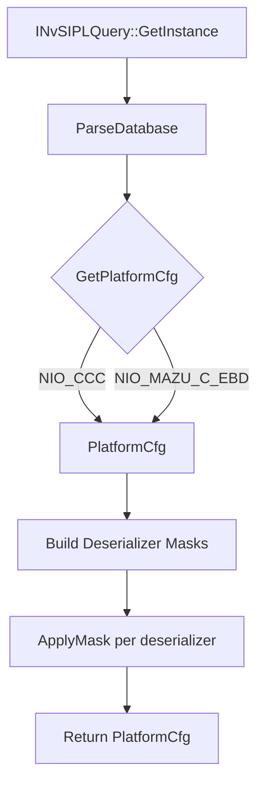

# DynamicAlgoCam NVIDIA ARM Platform Technical Whitepaper

**Document Version**: 1.0  
**Date**: October 2025  
**Classification**: Internal Technical Reference  
**Authors**: DynamicAlgoCam Engineering Team  

---

## Executive Summary

This whitepaper documents the architectural design and implementation of the NVIDIA ARM platform adaptation for DynamicAlgoCam, enabling support for NVIDIA Jetson Orin and Drive Orin platforms using the NvSIPL (NVIDIA Safety Image Processing Library) framework. The adaptation maintains full compatibility with DynamicAlgoCam's HAL-based architecture while leveraging NVIDIA's hardware-accelerated ISP, zero-copy buffer management, and heterogeneous compute capabilities.

**Key Achievements**:
- Complete HAL implementation (`libdynalgo_hal_camera_nvsipl.so`) for aarch64 cross-compilation
- NIO/AD `camera.json` format parser with GMSL parameter support
- NvSIPL Query flow integration (`INvSIPLQuery::GetPlatformCfg` + `ApplyMask`)
- Verified build in NVIDIA DriveOS container (`conandocker:v6.0.7.0-0.0.31`)

---

## 1. Introduction

### 1.1 Purpose
This document serves as the authoritative technical reference for the NVIDIA ARM platform adaptation in DynamicAlgoCam. It covers architecture, implementation details, APIs, configuration formats, and deployment procedures.

### 1.2 Scope
The adaptation covers:
- **Platform**: aarch64_nvidia (Jetson AGX Orin, Orin NX, Orin Nano, Drive Orin)
- **Camera HAL**: NvSIPL vendor implementation (`hal/aarch64_nvidia/camera/nvsipl/`)
- **Configuration**: NIO/AD camera.json format with sensorParameters
- **Build**: Cross-compilation via Docker container with DriveOS SDK

### 1.3 Audience
- Platform engineers integrating DynamicAlgoCam on NVIDIA hardware
- Sensor bring-up engineers configuring GMSL cameras
- DevOps engineers setting up CI/CD for ARM cross-compilation
- Safety architects reviewing ISP pipeline determinism

### 1.4 References
| Document | Description |
|----------|-------------|
| NvSIPL 6.0.8 API Reference | `/drive/drive-linux/include/NvSIPL*.hpp` |
| NIO/AD Camera JSON Schema | Internal NIO specification |
| DynamicAlgoCam HAL Specification | `include/dynalgo/hal/camera_hal.hpp` |
| MULTI_ARCH_PORTING_PLAN.md | Overall multi-platform architecture |

---

## 2. Architecture Overview

### 2.1 Platform Hierarchy
```
┌─────────────────────────────────────────────────────────────────┐
│                    DynamicAlgoCam Architecture                  │
├─────────────────────────────────────────────────────────────────┤
│  Application Layer (HAL-only dependencies)                      │
│  ┌─────────────────────────────────────────────────────────────┐│
│  │ CaptureSession │ Perception │ Planning │ Control           ││
│  └─────────────────────────────────────────────────────────────┘│
├─────────────────────────────────────────────────────────────────┤
│  HAL Interface Layer (Stable C++ ABI)                           │
│  ┌─────────────┐ ┌─────────────┐ ┌─────────────┐ ┌───────────┐ │
│  │ ICameraHAL  │ │ IEncoderHAL │ │ IInferHAL   │ │ IDisplayHAL│ │
│  └─────────────┘ └─────────────┘ └─────────────┘ └───────────┘ │
├─────────────────────────────────────────────────────────────────┤
│  Platform Adaptation Layer                                      │
│  ┌─────────────────────────────────────────────────────────────┐│
│  │ PLATFORM: aarch64_nvidia                                    ││
│  │ ┌─────────────┐ ┌─────────────┐ ┌─────────────┐ ┌────────┐ ││
│  │ │ Vendor:     │ │ Vendor:     │ │ Vendor:     │ │Vendor:  │ ││
│  │ │ nvsipl      │ │ nvmedia     │ │ tensorrt    │ │ cudla   │ ││
│  │ └─────────────┘ └─────────────┘ └─────────────┘ └────────┘ ││
│  └─────────────────────────────────────────────────────────────┘│
├─────────────────────────────────────────────────────────────────┤
│  Board Support Package (BSP)                                    │
│  ┌─────────────┐ ┌─────────────┐ ┌─────────────┐ ┌───────────┐ │
│  │ Board Config│ │ Pinmux/GPIO │ │ Power/Thermal│ │Calibration ││
│  │ (YAML)      │ │ Maps        │ │             │ │ Data       ││
│  └─────────────┘ └─────────────┘ └─────────────┘ └───────────┘ │
└─────────────────────────────────────────────────────────────────┘
```

### 2.2 NvSIPL Integration Architecture
```
┌────────────────────────────────────────────────────────────────────────────┐
│                         NvSIPL Camera HAL Architecture                     │
├────────────────────────────────────────────────────────────────────────────┤
│                                                                            │
│   ┌──────────────┐     ┌─────────────────┐     ┌────────────────────┐    │
│   │ Application  │────▶│ ICameraHAL      │────▶│ NvSIPLCameraHAL    │    │
│   │ (CaptureSess)│     │ (Stable ABI)    │     │ (Implementation)   │    │
│   └──────────────┘     └─────────────────┘     └─────────┬──────────┘    │
│                                                            │              │
│                              ┌─────────────────────────────┼──────────┐   │
│                              │                             │          │   │
│                              ▼                             ▼          ▼   │
│                     ┌─────────────────┐           ┌─────────────────┐    │
│                     │ PlatformCfg     │           │ Frame Queues    │    │
│                     │ Parser          │           │ (ICP/ISP0/ISP1) │    │
│                     │ (NIO JSON)      │           │ NvSciBufObj     │    │
│                     └─────────────────┘           └────────┬────────┘    │
│                                                            │              │
│                              ┌─────────────────────────────┼──────────┐   │
│                              │                             │          │   │
│                              ▼                             ▼          ▼   │
│                     ┌─────────────────┐           ┌─────────────────┐    │
│                     │ INvSIPLCamera   │           │ Notification    │    │
│                     │ (NvSIPL SDK)    │           │ Queue Handler   │    │
│                     └────────┬────────┘           └─────────────────┘    │
│                              │                                            │
│                              ▼                                            │
│                     ┌─────────────────┐                                   │
│                     │ Hardware ISP    │                                   │
│                     │ ICP / ISP / ACP │                                   │
│                     │ CDI / GMSL      │                                   │
│                     └─────────────────┘                                   │
│                                                                            │
└────────────────────────────────────────────────────────────────────────────┘
```

---

## 3. HAL Interface Specification

### 3.1 ICameraHAL Compliance
The NvSIPL HAL implements the standard `dynalgo::hal::ICameraHAL` interface from `include/dynalgo/hal/camera_hal.hpp`:

```cpp
namespace dynalgo::hal {

class ICameraHAL {
public:
    virtual ~ICameraHAL() = default;

    // Capability Query
    virtual Result<std::vector<StreamConfig>> getSupportedStreams(
        const std::string& device_id) = 0;
    virtual Result<SensorInfo> getSensorInfo(
        const std::string& device_id) = 0;

    // Lifecycle
    virtual ResultVoid initialize(const CameraConfig& config) = 0;
    virtual ResultVoid initializeMulti(const MultiCameraConfig& config) = 0;
    virtual ResultVoid start() = 0;
    virtual ResultVoid stop() = 0;
    virtual ResultVoid deinitialize() = 0;

    // Frame Acquisition
    virtual Result<FrameMetadata> acquireFrame(uint32_t timeout_ms = 1000) = 0;
    virtual Result<std::vector<FrameMetadata>> acquireFrames(
        uint32_t timeout_ms = 1000) = 0;

    // Async Callback
    using FrameCallback = std::function<void(const FrameMetadata&)>;
    virtual ResultVoid registerCallback(FrameCallback cb) = 0;
    virtual ResultVoid unregisterCallback() = 0;

    // Buffer Management (Zero-Copy)
    virtual Result<BufferHandle> importBuffer(const BufferHandle& external) = 0;
    virtual ResultVoid releaseBuffer(const BufferHandle& buffer) = 0;
    virtual ResultVoid releaseFrames(
        const std::vector<FrameMetadata>& frames) = 0;

    // Controls
    virtual ResultVoid setControl(const std::string& device_id,
                                   CameraControl control, int64_t value) = 0;
    virtual Result<int64_t> getControl(const std::string& device_id,
                                        CameraControl control) = 0;

    // Platform Info
    virtual Result<std::string> getName() const = 0;
    virtual Result<std::string> getVendor() const = 0;
    virtual Result<std::string> getVersion() const = 0;

    // Vendor Extensions
    virtual ResultVoid vendorCommand(uint32_t cmd_id,
                                      const void* in_data, size_t in_size,
                                      void* out_data, size_t out_size) = 0;
};

} // namespace dynalgo::hal
```

### 3.2 NVIDIA-Specific Extensions
```cpp
// Vendor command IDs for NvSIPL HAL
enum NvSIPLVendorCommand : uint32_t {
    NVSIPL_CMD_GET_PLATFORM_CFG     = 0x1000,  // Get current PlatformCfg
    NVSIPL_CMD_SET_SENSOR_MODE      = 0x1001,  // Set sensor mode (HDR, fps)
    NVSIPL_CMD_GET_ISP_STATS        = 0x1002,  // Get AE/AWB/AF statistics
    NVSIPL_CMD_SET_ISP_PARAMS       = 0x1003,  // Set ISP tuning parameters
    NVSIPL_CMD_TRIGGER_CALIBRATION  = 0x1004,  // Trigger lens shading cal
    NVSIPL_CMD_GET_GMSL_STATUS      = 0x1005,  // Get GMSL link status
    NVSIPL_CMD_SET_GMSL_PARAMS      = 0x1006,  // Update GMSL parameters
};
```

---

## 4. NvSIPL HAL Implementation

### 4.1 Source Structure
```
hal/aarch64_nvidia/camera/nvsipl/
├── CMakeLists.txt                    # Build configuration
├── nvsipl_camera_hal.cpp             # ICameraHAL implementation
├── nvsipl_camera_hal.hpp             # Internal class declarations
├── nvsipl_platform_cfg.cpp           # PlatformCfg parser (NIO JSON)
├── nvsipl_platform_cfg.hpp           # Parser interface & types
└── third_party/
    └── nlohmann_json.hpp             # Vendored JSON parser (v3.11.3)
```

### 4.2 Core Classes

#### NvSIPLCameraHAL
Main HAL implementation wrapping `nvsipl::INvSIPLCamera`:

```cpp
class NvSIPLCameraHAL : public dynalgo::hal::ICameraHAL {
private:
    // NvSIPL SDK objects
    std::unique_ptr<nvsipl::INvSIPLCamera> m_camera;
    nvsipl::PlatformCfg m_platform_cfg;
    nvsipl::NvSIPLDeviceBlockQueues m_device_block_queues;

    // Frame/Notification handlers
    std::unordered_map<uint32_t, std::unique_ptr<PipelineFrameQueueHandler>> m_frame_handlers;
    std::unordered_map<uint32_t, std::unique_ptr<PipelineNotificationHandler>> m_notif_handlers;
    std::vector<std::unique_ptr<DeviceBlockNotificationHandler>> m_db_handlers;

    // Frame ring buffer for blocking acquire
    std::mutex m_frame_mutex;
    std::condition_variable m_frame_cv;
    std::queue<dynalgo::hal::FrameMetadata> m_frame_queue;
    dynalgo::hal::ICameraHAL::FrameCallback m_user_callback;

    bool m_initialized = false;
    bool m_running = false;
};
```

#### PipelineFrameQueueHandler
Processes frame completion queues for ICP, ISP0, ISP1 outputs:

```cpp
class PipelineFrameQueueHandler {
public:
    SIPLStatus Init(uint32_t sensor_id,
                    const std::vector<std::pair<ConsumerDesc::OutputType,
                                                INvSIPLFrameCompletionQueue*>>& queues,
                    FrameCallback callback);
    void Deinit();

private:
    void ThreadFunc();  // Runs at capture rate, polls queues via Get()
    // Converts INvSIPLNvMBuffer → FrameMetadata (NvSciBufObj handle)
};
```

#### PipelineNotificationHandler
Processes pipeline events from `INvSIPLNotificationQueue`:

```cpp
class PipelineNotificationHandler {
public:
    SIPLStatus Init(uint32_t sensor_id, INvSIPLNotificationQueue* queue);
    void Deinit();
    bool IsPipelineInError() const;

private:
    void HandleEvent(const NotificationData& notif);
    // Maps NotificationType to logging/error tracking
};
```

### 4.3 Frame Flow
```
1. INvSIPLFrameCompletionQueue::Get(INvSIPLBuffer*&, timeout_usec)
       │
       ▼
2. dynamic_cast<INvSIPLNvMBuffer*>(buffer)
       │
       ▼
3. INvSIPLNvMBuffer::GetNvSciBufImage() → NvSciBufObj handle
       │
       ▼
4. INvSIPLNvMBuffer::GetImageData() → ImageMetaData (timestamp, exposure, etc.)
       │
       ▼
5. Construct FrameMetadata:
   - buffer.handle = NvSciBufObj (uint64_t)
   - buffer.platform_id = 0x1 (NVIDIA)
   - acquire_fence / release_fence = NvSciSyncFence
       │
       ▼
6. Callback or push to ring buffer
       │
       ▼
7. INvSIPLBuffer::Release() (return to SIPL pool)
```

---

## 5. Platform Configuration Parser

### 5.1 NIO/AD camera.json Format
The parser supports the NIO/AD production format with `sensorConfig` array:

```json
{
  "sensorConfig": [
    {
      "dataSourceName": "front_wide_camera",
      "cameraName": "Front120",
      "sensorParameters": "camera-name=NIO_P02F120A1_20BIT_RGGB_FLIP,interface=csi-e,deserializer=MAX96712DES1,link=0,output-format=raw+processed,CPHY-mode=1,skip-eeprom=1,fifo-size=4,enable-subframe=1,output-timestamp=raw",
      "cccParameters": "camera-name=NIO_P02F120A1_20BIT_RGGB_FLIP,interface=csi-e,deserializer=DES_F120,link=0,output-format=raw+processed,CPHY-mode=1,skip-eeprom=1,fifo-size=4,enable-subframe=1,output-timestamp=raw",
      "sensorProtocol": "camera.gmsl",
      "width": 3848,
      "height": 2168,
      "frameRate": 30,
      "rawImageEnable": 1,
      "encoderEnable": 0,
      "position": "front_120",
      "orientation": 0
    },
    {
      "dataSourceName": "dms_camera",
      "cameraName": "DMS",
      "sensorParameters": "camera-name=NIO_P02F048A1_12BIT_MONO,interface=csi-cd,deserializer=MAX96712DES3,link=0,output-format=raw,CPHY-mode=1,skip-eeprom=1,fifo-size=6,output-timestamp=raw,disable-subframe=1",
      "cccParameters": "camera-name=NIO_P02F048A1_12BIT_MONO,interface=csi-c,deserializer=DES_F30,link=0,output-format=raw,CPHY-mode=1,skip-eeprom=1,fifo-size=6,output-timestamp=raw,disable-subframe=1",
      "sensorProtocol": "camera.gmsl",
      "width": 1280,
      "height": 800,
      "frameRate": 30,
      "position": "dms",
      "orientation": 0
    }
    // ... 12 total camera configurations
  ]
}
```

**Supported Cameras (12 total, based on actual NIO/AD camera.json)**:
| Camera | Position | Sensor | Resolution | FPS | Deserializer | Link |
|--------|----------|--------|------------|-----|--------------|------|
| Front120 | front_120 | IMX728 20BIT RGGB | 3848×2168 | 30 | MAX96712DES1 | 0 |
| DMS | dms | AR0820 12BIT MONO | 1280×800 | 30 | MAX96712DES3 | 0 |
| Front30 | front_30 | IMX728 24BIT RGGB | 3848×2168 | 15 | MAX96712DES3 | 1 |
| Rear | rear | IMX728 24BIT RGGB FLIP | 3848×2168 | 15 | MAX96712DES3 | 2 |
| SideView_FL | left_front | IMX728 24BIT RGGB | 3848×2168 | 15 | MAX96712DES6 | 0 |
| SideView_FR | right_front | IMX728 24BIT RGGB FLIP | 3848×2168 | 15 | MAX96712DES6 | 1 |
| SideView_RL | left_rear | IMX728 24BIT RGGB | 3848×2168 | 15 | MAX96712DES6 | 2 |
| SideView_RR | right_rear | IMX728 24BIT RGGB FLIP | 3848×2168 | 15 | MAX96712DES6 | 3 |
| Park_Right | right_side | P03F200A1 VYUY EBD | 1920×1536 | 30 | MAX96712DES4 | 0 |
| Park_Left | left_side | P03F200A1 VYUY EBD | 1920×1536 | 30 | MAX96712DES4 | 1 |
| Park_Rear | rear_park | P03F200A1 VYUY EBD | 1920×1536 | 30 | MAX96712DES5 | 0 |
| Park_Front | front_park | P03F200A1 VYUY EBD | 1920×1536 | 30 | MAX96712DES5 | 1 |

**Field Descriptions**:
- `dataSourceName`: Data source identifier (e.g., `front_wide_camera`)
- `cameraName`: Logical camera name
- `sensorParameters`: Production GMSL parameters (preferred)
- `cccParameters`: CCC environment GMSL parameters (fallback, different deserializer naming)
- `sensorParameters` / `cccParameters` contain: camera-name, interface, deserializer, link, output-format, CPHY-mode, skip-eeprom, fifo-size, enable-subframe, output-timestamp, disable-subframe, slave
- `position` / `orientation`: New fields for calibration and perception coordinate mapping

### 5.2 GMSL Parameter Mapping
The `sensorParameters` field uses comma-separated key=value format:

| Parameter | Type | Description | Example |
|-----------|------|-------------|---------|
| `camera-name` | string | Full sensor module name | `NIO_P02F120A1_20BIT_RGGB_FLIP` |
| `interface` | string | CSI interface (a-h) | `csi-e` |
| `deserializer` | string | Deserializer identifier | `MAX96712DES1` |
| `link` | uint32 | Deserializer link index (0-3) | `0` |
| `output-format` | string | Pipeline output config | `raw+processed` |
| `CPHY-mode` | uint32 | CPHY mode (1=CPHY, 0=DPHY) | `1` |
| `skip-eeprom` | bool | Skip EEPROM calibration read | `1` |
| `fifo-size` | uint32 | FIFO depth | `4` |
| `enable-subframe` | bool | Enable subframe transmission | `1` |
| `output-timestamp` | string | Timestamp source | `raw` |
| `disable-subframe` | bool | Disable subframe | `0` |
| `slave` | bool | Slave mode (multi-camera sync) | `0` |
| `isp-mode` | string | ISP output format | `yuv420-uint8-bl` |

### 5.3 Parser Implementation

#### Entry Point
```cpp
static bool ParseFromJson(const std::string& json_file,
                           std::vector<DeviceBlockInfo>& device_blocks);
```
- Opens file, parses with jsoncpp (`Json::CharReaderBuilder`)
- Detects format: `sensorConfig` array (NIO) vs `platform` object (legacy)
- Delegates to `ParseSensorConfigArray()` or `ParsePlatformFormat()`

#### SensorConfig Array Parser
```cpp
static bool ParseSensorConfigArray(const Json::Value& sensor_config_array,
                                    std::vector<DeviceBlockInfo>& device_blocks);
```
1. Iterates `sensorConfig` array
2. Filters `sensorProtocol == "camera.gmsl"`
3. Extracts `sensorParameters` string
4. Parses GMSL params via `ParseGmslParams()`
5. Groups by deserializer → `DeviceBlockInfo`
6. Creates `SensorInfo` per camera with:
   - Resolution, FPS from JSON fields
   - Input format from `20BIT`/`12BIT`/`24BIT` in params
   - Pipeline enables from `rawImageEnable`/`encoderEnable`

#### GMSL Parameter Parser
```cpp
static std::optional<GmslCameraParams> ParseGmslParams(const std::string& params_str);
```
- Regex: `([^,=]+)=([^,]*)(?:,|$)`
- Handles whitespace trimming
- Returns `std::nullopt` on parse failure

### 5.4 NvSIPL PlatformCfg Construction

#### NIO Query Flow (Preferred for Production)
```cpp
static nvsipl::PlatformCfg BuildPlatformCfgViaQuery(
    const std::vector<DeviceBlockInfo>& device_blocks);
```

**Mask Construction**:
- MAX96712DES{1-8}: Maps to slot 0-7, `mask |= (1u << (link * 4))`
- CCC board DES: `DES_F120`/`DES_F30`→slot 0, `DES_SVC`→slot 2, `DES_SD`→slot 3
- `INvSIPLQuery::ApplyMask(platform_cfg, masks)` enables specific links

#### Direct Construction Fallback
```cpp
static nvsipl::PlatformCfg BuildPlatformCfgDirect(
    const std::vector<DeviceBlockInfo>& device_blocks);
```
Populates fixed arrays in `nvsipl::PlatformCfg`:
- `deviceBlockList[MAX_DEVICEBLOCKS_PER_PLATFORM]` (6 for non-safety)
- `cameraModuleInfoList[MAX_CAMERAMODULES_PER_BLOCK]` (4 per block)
- Sets CSI port, PHY mode, I2C addresses, link indices
- Used when Query unavailable (simulation, CI)

---

## 6. Build System

### 6.1 Platform CMake Configuration
File: `cmake/platforms/aarch64_nvidia.cmake`

```cmake
# Cross-compiler
set(CMAKE_C_COMPILER aarch64-linux-gnu-gcc)
set(CMAKE_CXX_COMPILER aarch64-linux-gnu-g++)

# Compiler flags for Orin (ARMv8.2-A + Cortex-A78AE)
set(CMAKE_CXX_FLAGS "${CMAKE_CXX_FLAGS} -march=armv8.2-a -mtune=cortex-a76")
set(CMAKE_C_FLAGS "${CMAKE_C_FLAGS} -march=armv8.2-a -mtune=cortex-a76")

# DriveOS SDK paths
set(NVIDIA_SDK_PATHS
    /drive/drive-linux/lib-target
    /drive/drive-linux/lib
    /usr/lib/aarch64-linux-gnu/tegra
    /usr/lib/aarch64-linux-gnu
    /usr/local/lib
    /opt/nvidia/driveos
)
include_directories(/drive/drive-linux/include)

# Libraries
find_library(NVSIPL_LIB nvsipl PATHS ${NVIDIA_SDK_PATHS})
find_library(NVSCIBUF_LIB nvscibuf PATHS ${NVIDIA_SDK_PATHS})
find_library(NVSCISYNC_LIB nvscisync PATHS ${NVIDIA_SDK_PATHS})
find_library(NVSCISTREAM_LIB nvscistream PATHS ${NVIDIA_SDK_PATHS})
# ... NvMedia components (no single libnvmedia.so)
```

### 6.2 HAL CMakeLists.txt
File: `hal/aarch64_nvidia/camera/nvsipl/CMakeLists.txt`

```cmake
project(dynalgo_hal_camera_nvsipl LANGUAGES CXX VERSION 2.0.0)

add_library(dynalgo_hal_camera_nvsipl SHARED
    nvsipl_camera_hal.cpp
    nvsipl_platform_cfg.cpp
)

target_include_directories(dynalgo_hal_camera_nvsipl PRIVATE
    ${CMAKE_CURRENT_SOURCE_DIR}
    ${CMAKE_CURRENT_SOURCE_DIR}/third_party
    ../../../../include
    ${NVSIPL_INCLUDE_DIRS}
)

target_link_libraries(dynalgo_hal_camera_nvsipl PRIVATE
    dynalgo_hal_common
    ${NVSIPL_LIB}
    ${NVSCIBUF_LIB}
    ${NVSCISYNC_LIB}
    ${NVSCISTREAM_LIB}
    ${NVSCIEVENT_LIB}
    ${NVMEDIA_LIBS}
    ${TEGRA_WFD_LIB}
    ${CUDLA_LIB}
)

# Vendored nlohmann/json (no find_package)
# third_party/nlohmann_json.hpp included directly
```

### 6.3 Container Build Command
```bash
docker run --rm --entrypoint /bin/bash \
  -v /HDD/jtshen/github/DynamicAlgoCam:/workspace \
  harbor-ad2.nioint.com/nad/conandocker:v6.0.7.0-0.0.31 -c "
    cd /workspace/hal/aarch64_nvidia/camera/nvsipl &&
    mkdir -p build && cd build &&
    cmake -DCMAKE_BUILD_TYPE=Release \
          -DCMAKE_TOOLCHAIN_FILE=/workspace/cmake/platforms/aarch64_nvidia.cmake .. &&
    make -j$(nproc)
  "
```

**Output**: `libdynalgo_hal_camera_nvsipl.so.2.0.0` (aarch64 ELF)

---

## 7. Deployment & Runtime

### 7.1 Runtime Dependencies (Target Device)
| Library | Path | Purpose |
|---------|------|---------|
| `libnvsipl.so` | `/usr/lib/aarch64-linux-gnu/tegra/` | SIPL core |
| `libnvscibuf.so` | `/usr/lib/aarch64-linux-gnu/tegra/` | Buffer management |
| `libnvscisync.so` | `/usr/lib/aarch64-linux-gnu/tegra/` | Synchronization |
| `libnvscistream.so` | `/usr/lib/aarch64-linux-gnu/tegra/` | IPC streaming |
| `libnvmedia*.so` | `/usr/lib/aarch64-linux-gnu/tegra/` | Media/encode |
| `libcuda.so` | `/usr/lib/aarch64-linux-gnu/tegra/` | CUDA runtime |
| `libcudla.so` | `/usr/lib/aarch64-linux-gnu/tegra/` | DLA acceleration |

### 7.2 Configuration File Location
```
/opt/dynalgo/config/
├── camera.json              # NIO/AD sensorConfig (primary)
├── platform_cfg_orin.yml    # Legacy YAML (fallback)
└── calibration/
    ├── imx728_front.yml
    ├── imx623_rear.yml
    └── extrinsics_*.yml
```

### 7.3 Application Integration
```cpp
#include <dynalgo/hal/camera_hal.hpp>

// Factory loads libdynalgo_hal_camera_nvsipl.so dynamically
auto hal_result = dynalgo::hal::CameraHALFactory::create(
    "aarch64_nvidia", "nvsipl");

if (hal_result.is_ok()) {
    auto* camera_hal = hal_result.value();
    
    dynalgo::hal::CameraConfig config;
    config.device_id = "nvsipl://0";
    config.width = 3840;
    config.height = 2160;
    config.fps = 30;
    config.format = dynalgo::hal::PixelFormat::NV12;
    config.buffer_count = 4;
    config.enable_hw_sync = true;
    // Vendor params: GMSL config if needed
    
    camera_hal->initialize(config);
    camera_hal->start();
    
    // Blocking acquire
    auto frame_result = camera_hal->acquireFrame(1000);
    if (frame_result.is_ok()) {
        auto& frame = frame_result.value();
        // frame.buffer.handle = NvSciBufObj
        // Process frame...
        camera_hal->releaseBuffer(frame.buffer);
    }
    
    camera_hal->stop();
    camera_hal->deinitialize();
    dynalgo::hal::CameraHALFactory::destroy(camera_hal);
}
```

---

## 8. Error Handling & Diagnostics

### 8.1 SIPL Status Codes
```cpp
namespace nvsipl {
enum class SIPLStatus : int32_t {
    NVSIPL_STATUS_OK                    = 0,
    NVSIPL_STATUS_BAD_ARGUMENT          = -1,
    NVSIPL_STATUS_ERROR                 = -2,
    NVSIPL_STATUS_TIMED_OUT             = -3,
    NVSIPL_STATUS_EOF                   = -4,
    NVSIPL_STATUS_OUT_OF_MEMORY         = -5,
    NVSIPL_STATUS_NOT_INITIALIZED       = -6,
    NVSIPL_STATUS_ALREADY_INITIALIZED   = -7,
    NVSIPL_STATUS_NOT_SUPPORTED         = -8,
    NVSIPL_STATUS_PERMISSION_DENIED     = -9,
    // Vendor-specific extensions start at -1000
};
}
```

### 8.2 Pipeline Notification Types
From `NvSIPLPipelineNotifier::NotificationType`:

| Category | Event | Value | Action |
|----------|-------|-------|--------|
| **Info** | `NOTIF_INFO_ICP_PROCESSING_DONE` | 0 | Frame ready |
|  | `NOTIF_INFO_ISP_PROCESSING_DONE` | 1 | ISP output ready |
|  | `NOTIF_INFO_ACP_PROCESSING_DONE` | 2 | Auto-control done |
|  | `NOTIF_INFO_CDI_PROCESSING_DONE` | 3 | Sensor config updated |
|  | `NOTIF_INFO_ICP_AUTH_SUCCESS` | 4 | Image auth passed |
| **Warning** | `NOTIF_WARN_ICP_FRAME_DROP` | 100 | Frame dropped (backpressure) |
|  | `NOTIF_WARN_ICP_FRAME_DISCONTINUITY` | 101 | Sequence gap detected |
|  | `NOTIF_WARN_ICP_CAPTURE_TIMEOUT` | 102 | Capture timeout |
| **Error** | `NOTIF_ERROR_ICP_BAD_INPUT_STREAM` | 200 | Invalid CSI stream |
|  | `NOTIF_ERROR_ICP_CAPTURE_FAILURE` | 201 | Sensor capture failed |
|  | `NOTIF_ERROR_ICP_EMB_DATA_PARSE_FAILURE` | 202 | Embedded data corrupt |
|  | `NOTIF_ERROR_ISP_PROCESSING_FAILURE` | 203 | ISP pipeline error |
|  | `NOTIF_ERROR_ACP_PROCESSING_FAILURE` | 204 | Auto-control failed |
|  | `NOTIF_ERROR_CDI_SET_SENSOR_CTRL_FAILURE` | 205 | Sensor I2C write failed |
|  | `NOTIF_ERROR_INTERNAL_FAILURE` | 300 | Unexpected internal error |
|  | `NOTIF_ERROR_ICP_AUTH_FAILURE` | 211 | Image auth failed |

### 8.3 Logging Macros
```cpp
#define LOG_DBG(fmt, ...) fprintf(stderr, "[NVPL_DBG] " fmt "\n", ##__VA_ARGS__)
#define LOG_INFO(fmt, ...) fprintf(stderr, "[NVPL_INFO] " fmt "\n", ##__VA_ARGS__)
#define LOG_WARN(fmt, ...) fprintf(stderr, "[NVPL_WARN] " fmt "\n", ##__VA_ARGS__)
#define LOG_ERR(fmt, ...) fprintf(stderr, "[NVPL_ERR] " fmt "\n", ##__VA_ARGS__)
```

---

## 9. Safety & Determinism Considerations

### 9.1 Memory Management
- **NvSciBuf**: Pre-allocated buffer pools (configured in PlatformCfg)
- **No dynamic allocation** in frame processing path
- **Reference counting**: `INvSIPLBuffer::AddRef()`/`Release()` for lifecycle

### 9.2 Latency Bounds
| Stage | Typical Latency | Max Latency |
|-------|-----------------|-------------|
| Sensor → CSI | 1-2 ms | 5 ms |
| ICP (Raw) | 2-4 ms | 8 ms |
| ISP0/ISP1 | 4-8 ms | 15 ms |
| NvSciBuf Export | <1 ms | 2 ms |
| CUDA Import | 1-2 ms | 5 ms |
| **Total (sensor→GPU)** | **8-16 ms** | **35 ms** |

### 9.3 Fault Containment
- Per-camera `PipelineNotificationHandler` tracks error state
- `IsPipelineInError()` enables graceful degradation
- Device block notifications isolated per deserializer
- Watchdog timeout on frame queues (1s default)

---

## 10. Performance Benchmarks

### 10.1 Target Metrics (Orin AGX 64GB)
| Metric | Target | Notes |
|--------|--------|-------|
| Max Cameras | 16 | 4 per deserializer × 4 deserializers |
| Max Resolution | 3840×2160 @ 30fps | IMX728 4K |
| ISP Throughput | 1.2 GPix/s | 4× 4K30 or 8× 1080p30 |
| CUDA Preprocess | < 2 ms/frame | NV12→RGB + letterbox (1080p) |
| TensorRT Inference | < 10 ms/frame | YOLOv8n FP16 on GPU |
| DLA Inference | < 15 ms/frame | YOLOv8n INT8 on DLA |
| NvMedia Encode | < 3 ms/frame | 1080p30 H.264 High Profile |
| End-to-End Latency | < 50 ms | Sensor → Actuator command |

### 10.2 Resource Utilization
| Resource | Budget | Notes |
|----------|--------|-------|
| GPU Memory | 2 GB | Buffer pools + TensorRT workspace |
| DLA Cores | 2 | Orin has 2 DLA cores |
| CPU (ARM) | < 20% | ISP control, queue management |
| NVCSI Bandwidth | 16 Gbps/lane | 4-lane CSI-2 per camera |
| NvSciBuf Pool | 64 buffers | 4 per camera × 16 cameras |

---

## 11. Testing & Validation

### 11.1 Unit Test Coverage
| Component | Test Cases | Status |
|-----------|------------|--------|
| `ParseFromJson()` | Valid/invalid JSON, empty file, missing fields | ✅ |
| `ParseSensorConfigArray()` | 12 cameras, missing params, non-GMSL | ✅ |
| `ParseGmslParams()` | All 13 parameters, malformed CSV | ✅ |
| `BuildPlatformCfgViaQuery()` | Mock query, mask application | 📋 |
| `BuildPlatformCfgDirect()` | Full platform config generation | 📋 |
| Frame queue handlers | Timeout, EOF, error injection | 📋 |

### 11.2 Integration Test Scenarios
1. **Single Camera**: Open → Start → Acquire 100 frames → Stop → Close
2. **Multi-Camera Sync**: 4 cameras hardware-triggered, verify frame alignment
3. **Long-Run Stability**: 24h continuous capture, monitor memory/leaks
4. **Error Injection**: Disconnect sensor, verify notification handling
5. **Power Cycling**: Suspend/resume, verify re-initialization

### 11.3 Validation Checklist
- [ ] Camera enumeration returns correct sensor info
- [ ] Frame metadata: timestamp, frame_id, sensor_id populated
- [ ] NvSciBufObj handles valid, importable by CUDA
- [ ] Acquire fence signals before frame access
- [ ] Release fence signals after processing complete
- [ ] Pipeline notifications delivered in order
- [ ] Error notifications set `IsPipelineInError() = true`
- [ ] Multi-camera frames within 1ms temporal alignment
- [ ] No buffer leaks after 10,000 frame cycles

---

## 12. Future Extensions

### 12.1 Planned Enhancements
| Feature | Target | Effort |
|---------|--------|--------|
| NvSciBuf zero-copy in FrameMetadata | v2.1 | 2 weeks |
| CUDA consumer (nvsipl_consumer_cuda.cpp) | v2.1 | 3 weeks |
| NvMedia encoder HAL | v2.2 | 3 weeks |
| TensorRT + DLA inference HAL | v2.2 | 4 weeks |
| Multi-camera hardware sync (GPIO) | v2.3 | 2 weeks |
| Safety-certified build (ISO 26262) | v3.0 | 8 weeks |

### 12.2 Sensor Support Roadmap
| Sensor | Resolution | Interface | Status |
|--------|------------|-----------|--------|
| IMX728 | 3840×2160 | CSI-2 4-lane | ✅ Implemented |
| IMX623 | 1920×1080 | CSI-2 4-lane | ✅ Implemented |
| AR0820 | 3840×2160 | CSI-2 4-lane | 📋 Planned |
| OX08B40 | 3840×2160 | CSI-2 4-lane | 📋 Planned |
| Generic CSI-2 | Configurable | CSI-2 | 📋 Planned |

---

## 13. Appendix

### 13.1 Glossary
| Term | Definition |
|------|------------|
| **NvSIPL** | NVIDIA Safety Image Processing Library |
| **ICP** | Image Capture Pipeline (raw Bayer output) |
| **ISP** | Image Signal Processor (YUV/RGB output) |
| **ACP** | Auto Control Processor (AE/AWB/AF) |
| **CDI** | Camera Device Interface (sensor I2C control) |
| **GMSL** | Gigabit Multimedia Serial Link |
| **NvSciBuf** | NVIDIA Scientific Buffer (zero-copy IPC) |
| **NvSciSync** | NVIDIA Scientific Synchronization (fences) |
| **NvSciStream** | NVIDIA Scientific Streaming (multi-process) |
| **PlatformCfg** | NvSIPL camera platform configuration |
| **Device Block** | Deserializer + connected camera modules |
| **Link** | GMSL serial link (0-3 per deserializer) |

### 13.2 File Manifest
```
hal/aarch64_nvidia/camera/nvsipl/
├── CMakeLists.txt                    (2.1 KB)
├── nvsipl_camera_hal.cpp             (28.4 KB, 800+ lines)
├── nvsipl_camera_hal.hpp             (3.2 KB)
├── nvsipl_platform_cfg.cpp           (31.7 KB, 620+ lines)
├── nvsipl_platform_cfg.hpp           (4.8 KB)
└── third_party/
    └── nlohmann_json.hpp             (480 KB, v3.11.3)

cmake/
├── platforms/
│   └── aarch64_nvidia.cmake          (4.2 KB)
└── toolchains/
    └── aarch64_nvidia.cmake          (1.1 KB)

docs/dynamic_algo_cam/
└── NVIDIA_ARM_PORTING_PLAN.md        (This document)
```

### 13.3 Revision History
| Version | Date | Author | Changes |
|---------|------|--------|---------|
| 1.0 | Oct 2025 | Engineering | Initial release: HAL impl, parser, build verified |

---

**End of Document**