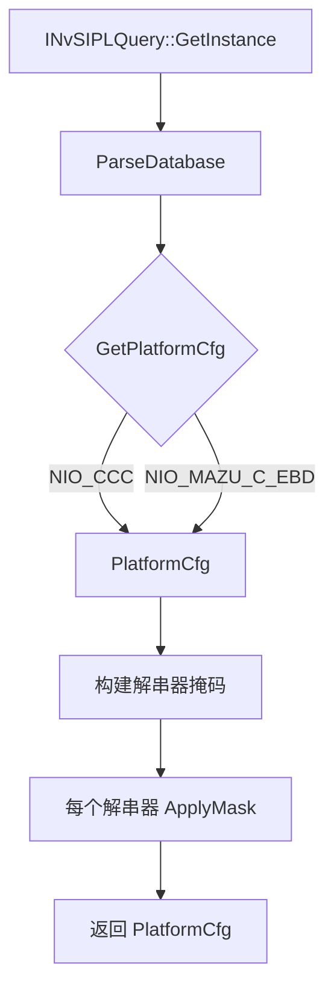

# DynamicAlgoCam NVIDIA ARM 平台技术白皮书

**文档版本**: 1.0  
**日期**: 2025年10月  
**密级**: 内部技术参考  
**作者**: DynamicAlgoCam 工程团队  

---

## 摘要

本白皮书记录了 DynamicAlgoCam NVIDIA ARM 平台适配的架构设计与实现，使其支持 NVIDIA Jetson Orin 与 Drive Orin 平台，采用 NvSIPL（NVIDIA Safety Image Processing Library）框架。该适配完全兼容 DynamicAlgoCam 基于 HAL 的架构，同时利用 NVIDIA 的硬件加速 ISP、零拷贝缓冲管理与异构计算能力。

**关键成果**：
- 完整的 HAL 实现 (`libdynalgo_hal_camera_nvsipl.so`) 支持 aarch64 交叉编译
- NIO/AD `camera.json` 格式解析器，支持 GMSL 参数
- NvSIPL Query 流程集成 (`INvSIPLQuery::GetPlatformCfg` + `ApplyMask`)
- 在 NVIDIA DriveOS 容器 (`conandocker:v6.0.7.0-0.0.31`) 中验证构建通过

---

## 1. 引言

### 1.1 目的
本文档作为 DynamicAlgoCam NVIDIA ARM 平台适配的权威技术参考，涵盖架构、实现细节、API、配置格式与部署流程。

### 1.2 范围
本适配覆盖：
- **平台**: aarch64_nvidia (Jetson AGX Orin, Orin NX, Orin Nano, Drive Orin)
- **Camera HAL**: NvSIPL 厂商实现 (`hal/aarch64_nvidia/camera/nvsipl/`)
- **配置**: NIO/AD camera.json 格式与 sensorParameters
- **构建**: 通过 Docker 容器与 DriveOS SDK 交叉编译

### 1.3 受众
- 在 NVIDIA 硬件上集成 DynamicAlgoCam 的平台工程师
- 配置 GMSL 相机的传感器带板工程师
- 建立 ARM 交叉编译 CI/CD 的 DevOps 工程师
- 评审 ISP 流水线确定性的安全架构师

### 1.4 参考文档
| 文档 | 说明 |
|------|------|
| NvSIPL 6.0.8 API 参考 | `/drive/drive-linux/include/NvSIPL*.hpp` |
| NIO/AD Camera JSON Schema | NIO 内部规范 |
| DynamicAlgoCam HAL 规范 | `include/dynalgo/hal/camera_hal.hpp` |
| MULTI_ARCH_PORTING_PLAN.md | 总体多平台架构 |

---

## 2. 架构概览

### 2.1 平台层级
```
┌─────────────────────────────────────────────────────────────────┐
│                    DynamicAlgoCam 架构                          │
├─────────────────────────────────────────────────────────────────┤
│  应用层 (仅依赖 HAL 接口)                                       │
│  ┌─────────────────────────────────────────────────────────────┐│
│  │ CaptureSession │ Perception │ Planning │ Control           ││
│  └─────────────────────────────────────────────────────────────┘│
├─────────────────────────────────────────────────────────────────┤
│  HAL 接口层 (稳定 C++ ABI)                                      │
│  ┌─────────────┐ ┌─────────────┐ ┌─────────────┐ ┌───────────┐ │
│  │ ICameraHAL  │ │ IEncoderHAL │ │ IInferHAL   │ │ IDisplayHAL│ │
│  └─────────────┘ └─────────────┘ └─────────────┘ └───────────┘ │
├─────────────────────────────────────────────────────────────────┤
│  平台适配层                                                     │
│  ┌─────────────────────────────────────────────────────────────┐│
│  │ PLATFORM: aarch64_nvidia                                    ││
│  │ ┌─────────────┐ ┌─────────────┐ ┌─────────────┐ ┌────────┐ ││
│  │ │ Vendor:     │ │ Vendor:     │ │ Vendor:     │ │Vendor:  │ ││
│  │ │ nvsipl      │ │ nvmedia     │ │ tensorrt    │ │ cudla   │ ││
│  │ └─────────────┘ └─────────────┘ └─────────────┘ └────────┘ ││
│  └─────────────────────────────────────────────────────────────┘│
├─────────────────────────────────────────────────────────────────┤
│  板级支持包 (BSP)                                               │
│  ┌─────────────┐ ┌─────────────┐ ┌─────────────┐ ┌───────────┐ │
│  │ Board Config│ │ Pinmux/GPIO │ │ Power/Thermal│ │Calibration ││
│  │ (YAML)      │ │ Maps        │ │             │ │ Data       ││
│  └─────────────┘ └─────────────┘ └─────────────┘ └───────────┘ │
└─────────────────────────────────────────────────────────────────┘
```

### 2.2 NvSIPL 集成架构
```
┌────────────────────────────────────────────────────────────────────────────┐
│                         NvSIPL Camera HAL 架构                             │
├────────────────────────────────────────────────────────────────────────────┤
│                                                                            │
│   ┌──────────────┐     ┌─────────────────┐     ┌────────────────────┐    │
│   │ Application  │────▶│ ICameraHAL      │────▶│ NvSIPLCameraHAL    │    │
│   │ (CaptureSess)│     │ (Stable ABI)    │     │ (Implementation)   │    │
│   └──────────────┘     └─────────────────┘     └─────────┬──────────┘    │
│                                                            │              │
│                              ┌─────────────────────────────┼──────────┐   │
│                              │                             │          │   │
│                              ▼                             ▼          ▼   │
│                     ┌─────────────────┐           ┌─────────────────┐    │
│                     │ PlatformCfg     │           │ Frame Queues    │    │
│                     │ Parser          │           │ (ICP/ISP0/ISP1) │    │
│                     │ (NIO JSON)      │           │ NvSciBufObj     │    │
│                     └─────────────────┘           └────────┬────────┘    │
│                                                            │              │
│                              ┌─────────────────────────────┼──────────┐   │
│                              │                             │          │   │
│                              ▼                             ▼          ▼   │
│                     ┌─────────────────┐           ┌─────────────────┐    │
│                     │ INvSIPLCamera   │           │ Notification    │    │
│                     │ (NvSIPL SDK)    │           │ Queue Handler   │    │
│                     └────────┬────────┘           └─────────────────┘    │
│                              │                                            │
│                              ▼                                            │
│                     ┌─────────────────┐                                   │
│                     │ Hardware ISP    │                                   │
│                     │ ICP / ISP / ACP │                                   │
│                     │ CDI / GMSL      │                                   │
│                     └─────────────────┘                                   │
│                                                                            │
└────────────────────────────────────────────────────────────────────────────┘
```

---

## 3. HAL 接口规范

### 3.1 ICameraHAL 合规性
NvSIPL HAL 实现了标准的 `dynalgo::hal::ICameraHAL` 接口（来自 `include/dynalgo/hal/camera_hal.hpp`）：

```cpp
namespace dynalgo::hal {

class ICameraHAL {
public:
    virtual ~ICameraHAL() = default;

    // 能力查询
    virtual Result<std::vector<StreamConfig>> getSupportedStreams(
        const std::string& device_id) = 0;
    virtual Result<SensorInfo> getSensorInfo(
        const std::string& device_id) = 0;

    // 生命周期
    virtual ResultVoid initialize(const CameraConfig& config) = 0;
    virtual ResultVoid initializeMulti(const MultiCameraConfig& config) = 0;
    virtual ResultVoid start() = 0;
    virtual ResultVoid stop() = 0;
    virtual ResultVoid deinitialize() = 0;

    // 帧获取
    virtual Result<FrameMetadata> acquireFrame(uint32_t timeout_ms = 1000) = 0;
    virtual Result<std::vector<FrameMetadata>> acquireFrames(
        uint32_t timeout_ms = 1000) = 0;

    // 异步回调
    using FrameCallback = std::function<void(const FrameMetadata&)>;
    virtual ResultVoid registerCallback(FrameCallback cb) = 0;
    virtual ResultVoid unregisterCallback() = 0;

    // 缓冲管理 (零拷贝)
    virtual Result<BufferHandle> importBuffer(const BufferHandle& external) = 0;
    virtual ResultVoid releaseBuffer(const BufferHandle& buffer) = 0;
    virtual ResultVoid releaseFrames(
        const std::vector<FrameMetadata>& frames) = 0;

    // 控制
    virtual ResultVoid setControl(const std::string& device_id,
                                   CameraControl control, int64_t value) = 0;
    virtual Result<int64_t> getControl(const std::string& device_id,
                                        CameraControl control) = 0;

    // 平台信息
    virtual Result<std::string> getName() const = 0;
    virtual Result<std::string> getVendor() const = 0;
    virtual Result<std::string> getVersion() const = 0;

    // 厂商扩展
    virtual ResultVoid vendorCommand(uint32_t cmd_id,
                                      const void* in_data, size_t in_size,
                                      void* out_data, size_t out_size) = 0;
};

} // namespace dynalgo::hal
```

### 3.2 NVIDIA 特有扩展
```cpp
// NvSIPL HAL 厂商命令 ID
enum NvSIPLVendorCommand : uint32_t {
    NVSIPL_CMD_GET_PLATFORM_CFG     = 0x1000,  // 获取当前 PlatformCfg
    NVSIPL_CMD_SET_SENSOR_MODE      = 0x1001,  // 设置传感器模式 (HDR, fps)
    NVSIPL_CMD_GET_ISP_STATS        = 0x1002,  // 获取 AE/AWB/AF 统计
    NVSIPL_CMD_SET_ISP_PARAMS       = 0x1003,  // 设置 ISP 调优参数
    NVSIPL_CMD_TRIGGER_CALIBRATION  = 0x1004,  // 触发镜头阴影校准
    NVSIPL_CMD_GET_GMSL_STATUS      = 0x1005,  // 获取 GMSL 链路状态
    NVSIPL_CMD_SET_GMSL_PARAMS      = 0x1006,  // 更新 GMSL 参数
};
```

---

## 4. NvSIPL HAL 实现

### 4.1 源码结构
```
hal/aarch64_nvidia/camera/nvsipl/
├── CMakeLists.txt                    # 构建配置
├── nvsipl_camera_hal.cpp             # ICameraHAL 实现
├── nvsipl_camera_hal.hpp             # 内部类声明
├── nvsipl_platform_cfg.cpp           # PlatformCfg 解析器 (NIO JSON)
├── nvsipl_platform_cfg.hpp           # 解析器接口与类型
└── third_party/
    └── nlohmann_json.hpp             # 内置 JSON 解析器 (v3.11.3)
```

### 4.2 核心类

#### NvSIPLCameraHAL
封装 `nvsipl::INvSIPLCamera` 的主 HAL 实现：

```cpp
class NvSIPLCameraHAL : public dynalgo::hal::ICameraHAL {
private:
    // NvSIPL SDK 对象
    std::unique_ptr<nvsipl::INvSIPLCamera> m_camera;
    nvsipl::PlatformCfg m_platform_cfg;
    nvsipl::NvSIPLDeviceBlockQueues m_device_block_queues;

    // 帧/通知处理器
    std::unordered_map<uint32_t, std::unique_ptr<PipelineFrameQueueHandler>> m_frame_handlers;
    std::unordered_map<uint32_t, std::unique_ptr<PipelineNotificationHandler>> m_notif_handlers;
    std::vector<std::unique_ptr<DeviceBlockNotificationHandler>> m_db_handlers;

    // 阻塞式 acquire 的帧环形缓冲
    std::mutex m_frame_mutex;
    std::condition_variable m_frame_cv;
    std::queue<dynalgo::hal::FrameMetadata> m_frame_queue;
    dynalgo::hal::ICameraHAL::FrameCallback m_user_callback;

    bool m_initialized = false;
    bool m_running = false;
};
```

#### PipelineFrameQueueHandler
处理 ICP、ISP0、ISP1 输出的帧完成队列：

```cpp
class PipelineFrameQueueHandler {
public:
    SIPLStatus Init(uint32_t sensor_id,
                    const std::vector<std::pair<ConsumerDesc::OutputType,
                                                INvSIPLFrameCompletionQueue*>>& queues,
                    FrameCallback callback);
    void Deinit();

private:
    void ThreadFunc();  // 按采集率运行，通过 Get() 轮询队列
    // 将 INvSIPLNvMBuffer → FrameMetadata (NvSciBufObj 句柄)
};
```

#### PipelineNotificationHandler
处理来自 `INvSIPLNotificationQueue` 的流水线事件：

```cpp
class PipelineNotificationHandler {
public:
    SIPLStatus Init(uint32_t sensor_id, INvSIPLNotificationQueue* queue);
    void Deinit();
    bool IsPipelineInError() const;

private:
    void HandleEvent(const NotificationData& notif);
    // 将 NotificationType 映射到日志/错误追踪
};
```

### 4.3 帧流向
```
1. INvSIPLFrameCompletionQueue::Get(INvSIPLBuffer*&, timeout_usec)
       │
       ▼
2. dynamic_cast<INvSIPLNvMBuffer*>(buffer)
       │
       ▼
3. INvSIPLNvMBuffer::GetNvSciBufImage() → NvSciBufObj 句柄
       │
       ▼
4. INvSIPLNvMBuffer::GetImageData() → ImageMetaData (时间戳、曝光等)
       │
       ▼
5. 构造 FrameMetadata:
   - buffer.handle = NvSciBufObj (uint64_t)
   - buffer.platform_id = 0x1 (NVIDIA)
   - acquire_fence / release_fence = NvSciSyncFence
       │
       ▼
6. 回调或推入环形缓冲
       │
       ▼
7. INvSIPLBuffer::Release() (归还 SIPL 池)
```

---

## 5. 平台配置解析器

### 5.1 NIO/AD camera.json 格式
解析器支持 NIO/AD 生产格式的 `sensorConfig` 数组：

```json
{
  "sensorConfig": [
    {
      "dataSourceName": "front_wide_camera",
      "cameraName": "Front120",
      "sensorParameters": "camera-name=NIO_P02F120A1_20BIT_RGGB_FLIP,interface=csi-e,deserializer=MAX96712DES1,link=0,output-format=raw+processed,CPHY-mode=1,skip-eeprom=1,fifo-size=4,enable-subframe=1,output-timestamp=raw",
      "cccParameters": "camera-name=NIO_P02F120A1_20BIT_RGGB_FLIP,interface=csi-e,deserializer=DES_F120,link=0,output-format=raw+processed,CPHY-mode=1,skip-eeprom=1,fifo-size=4,enable-subframe=1,output-timestamp=raw",
      "sensorProtocol": "camera.gmsl",
      "width": 3848,
      "height": 2168,
      "frameRate": 30,
      "rawImageEnable": 1,
      "encoderEnable": 0,
      "position": "front_120",
      "orientation": 0
    },
    {
      "dataSourceName": "dms_camera",
      "cameraName": "DMS",
      "sensorParameters": "camera-name=NIO_P02F048A1_12BIT_MONO,interface=csi-cd,deserializer=MAX96712DES3,link=0,output-format=raw,CPHY-mode=1,skip-eeprom=1,fifo-size=6,output-timestamp=raw,disable-subframe=1",
      "cccParameters": "camera-name=NIO_P02F048A1_12BIT_MONO,interface=csi-c,deserializer=DES_F30,link=0,output-format=raw,CPHY-mode=1,skip-eeprom=1,fifo-size=6,output-timestamp=raw,disable-subframe=1",
      "sensorProtocol": "camera.gmsl",
      "width": 1280,
      "height": 800,
      "frameRate": 30,
      "position": "dms",
      "orientation": 0
    }
    // ... 共 12 个相机配置
  ]
}
```

**支持相机 (共 12 个，基于实际 NIO/AD camera.json)**：
| 相机 | 位置 | 传感器 | 分辨率 | FPS | 解串器 | Link |
|------|------|--------|--------|-----|--------|------|
| Front120 | front_120 | IMX728 20BIT RGGB | 3848×2168 | 30 | MAX96712DES1 | 0 |
| DMS | dms | AR0820 12BIT MONO | 1280×800 | 30 | MAX96712DES3 | 0 |
| Front30 | front_30 | IMX728 24BIT RGGB | 3848×2168 | 15 | MAX96712DES3 | 1 |
| Rear | rear | IMX728 24BIT RGGB FLIP | 3848×2168 | 15 | MAX96712DES3 | 2 |
| SideView_FL | left_front | IMX728 24BIT RGGB | 3848×2168 | 15 | MAX96712DES6 | 0 |
| SideView_FR | right_front | IMX728 24BIT RGGB FLIP | 3848×2168 | 15 | MAX96712DES6 | 1 |
| SideView_RL | left_rear | IMX728 24BIT RGGB | 3848×2168 | 15 | MAX96712DES6 | 2 |
| SideView_RR | right_rear | IMX728 24BIT RGGB FLIP | 3848×2168 | 15 | MAX96712DES6 | 3 |
| Park_Right | right_side | P03F200A1 VYUY EBD | 1920×1536 | 30 | MAX96712DES4 | 0 |
| Park_Left | left_side | P03F200A1 VYUY EBD | 1920×1536 | 30 | MAX96712DES4 | 1 |
| Park_Rear | rear_park | P03F200A1 VYUY EBD | 1920×1536 | 30 | MAX96712DES5 | 0 |
| Park_Front | front_park | P03F200A1 VYUY EBD | 1920×1536 | 30 | MAX96712DES5 | 1 |

**字段说明**：
- `dataSourceName`: 数据源标识 (如 `front_wide_camera`)
- `cameraName`: 相机逻辑名称
- `sensorParameters`: 生产环境 GMSL 参数 (优先使用)
- `cccParameters`: CCC 环境 GMSL 参数 (回退使用，deserializer 命名不同)
- `sensorParameters` / `cccParameters` 包含：camera-name, interface, deserializer, link, output-format, CPHY-mode, skip-eeprom, fifo-size, enable-subframe, output-timestamp, disable-subframe, slave
- `position` / `orientation`: 新增字段，用于标定与感知坐标系映射

### 5.2 GMSL 参数映射
`sensorParameters` 字段采用逗号分隔的 key=value 格式：

| 参数 | 类型 | 说明 | 示例 |
|------|------|------|------|
| `camera-name` | string | 完整传感器模组名 | `NIO_P02F120A1_20BIT_RGGB_FLIP` |
| `interface` | string | CSI 接口 (a-h) | `csi-e` |
| `deserializer` | string | 解串器标识 | `MAX96712DES1` |
| `link` | uint32 | 解串器链路索引 (0-3) | `0` |
| `output-format` | string | 流水线输出配置 | `raw+processed` |
| `CPHY-mode` | uint32 | CPHY 模式 (1=CPHY, 0=DPHY) | `1` |
| `skip-eeprom` | bool | 跳过 EEPROM 校准读取 | `1` |
| `fifo-size` | uint32 | FIFO 深度 | `4` |
| `enable-subframe` | bool | 启用子帧传输 | `1` |
| `output-timestamp` | string | 时间戳源 | `raw` |
| `disable-subframe` | bool | 禁用子帧 | `0` |
| `slave` | bool | 从模式 (多相机同步) | `0` |
| `isp-mode` | string | ISP 输出格式 | `yuv420-uint8-bl` |

### 5.3 解析器实现

#### 入口函数
```cpp
static bool ParseFromJson(const std::string& json_file,
                           std::vector<DeviceBlockInfo>& device_blocks);
```
- 打开文件，使用 jsoncpp 解析 (`Json::CharReaderBuilder`)
- 检测格式：`sensorConfig` 数组 (NIO) vs `platform` 对象 (legacy)
- 分派给 `ParseSensorConfigArray()` 或 `ParsePlatformFormat()`

#### SensorConfig 数组解析
```cpp
static bool ParseSensorConfigArray(const Json::Value& sensor_config_array,
                                    std::vector<DeviceBlockInfo>& device_blocks);
```
1. 遍历 `sensorConfig` 数组
2. 过滤 `sensorProtocol == "camera.gmsl"`
3. 提取 `sensorParameters` 字符串
4. 通过 `ParseGmslParams()` 解析 GMSL 参数
5. 按解串器分组 → `DeviceBlockInfo`
6. 每个相机创建 `SensorInfo`，包含：
   - 来自 JSON 字段的分辨率、FPS
   - 从参数中 `20BIT`/`12BIT`/`24BIT` 推断输入格式
   - 来自 `rawImageEnable`/`encoderEnable` 的流水线启用标志

#### GMSL 参数解析
```cpp
static std::optional<GmslCameraParams> ParseGmslParams(const std::string& params_str);
```
- 正则：`([^,=]+)=([^,]*)(?:,|$)`
- 处理空白字符修剪
- 解析失败返回 `std::nullopt`

### 5.4 NvSIPL PlatformCfg 构建

#### NIO Query 流程 (生产环境首选)
```cpp
static nvsipl::PlatformCfg BuildPlatformCfgViaQuery(
    const std::vector<DeviceBlockInfo>& device_blocks);
```

**掩码构建**：
- MAX96712DES{1-8}: 映射到槽位 0-7，`mask |= (1u << (link * 4))`
- CCC 板 DES: `DES_F120`/`DES_F30`→槽位 0, `DES_SVC`→槽位 2, `DES_SD`→槽位 3
- `INvSIPLQuery::ApplyMask(platform_cfg, masks)` 启用特定链路

#### 直接构建回退
```cpp
static nvsipl::PlatformCfg BuildPlatformCfgDirect(
    const std::vector<DeviceBlockInfo>& device_blocks);
```
填充 `nvsipl::PlatformCfg` 的固定数组：
- `deviceBlockList[MAX_DEVICEBLOCKS_PER_PLATFORM]` (非安全版为 6)
- `cameraModuleInfoList[MAX_CAMERAMODULES_PER_BLOCK]` (每块 4 个)
- 设置 CSI 端口、PHY 模式、I2C 地址、链路索引
- Query 不可用时使用 (仿真、CI)

---

## 6. 构建系统

### 6.1 平台 CMake 配置
文件：`cmake/platforms/aarch64_nvidia.cmake`

```cmake
# 交叉编译器
set(CMAKE_C_COMPILER aarch64-linux-gnu-gcc)
set(CMAKE_CXX_COMPILER aarch64-linux-gnu-g++)

# Orin 编译器标志 (ARMv8.2-A + Cortex-A78AE)
set(CMAKE_CXX_FLAGS "${CMAKE_CXX_FLAGS} -march=armv8.2-a -mtune=cortex-a76")
set(CMAKE_C_FLAGS "${CMAKE_C_FLAGS} -march=armv8.2-a -mtune=cortex-a76")

# DriveOS SDK 路径
set(NVIDIA_SDK_PATHS
    /drive/drive-linux/lib-target
    /drive/drive-linux/lib
    /usr/lib/aarch64-linux-gnu/tegra
    /usr/lib/aarch64-linux-gnu
    /usr/local/lib
    /opt/nvidia/driveos
)
include_directories(/drive/drive-linux/include)

# 库
find_library(NVSIPL_LIB nvsipl PATHS ${NVIDIA_SDK_PATHS})
find_library(NVSCIBUF_LIB nvscibuf PATHS ${NVIDIA_SDK_PATHS})
find_library(NVSCISYNC_LIB nvscisync PATHS ${NVIDIA_SDK_PATHS})
find_library(NVSCISTREAM_LIB nvscistream PATHS ${NVIDIA_SDK_PATHS})
# ... NvMedia 组件库 (无单一 libnvmedia.so)
```

### 6.2 HAL CMakeLists.txt
文件：`hal/aarch64_nvidia/camera/nvsipl/CMakeLists.txt`

```cmake
project(dynalgo_hal_camera_nvsipl LANGUAGES CXX VERSION 2.0.0)

add_library(dynalgo_hal_camera_nvsipl SHARED
    nvsipl_camera_hal.cpp
    nvsipl_platform_cfg.cpp
)

target_include_directories(dynalgo_hal_camera_nvsipl PRIVATE
    ${CMAKE_CURRENT_SOURCE_DIR}
    ${CMAKE_CURRENT_SOURCE_DIR}/third_party
    ../../../../include
    ${NVSIPL_INCLUDE_DIRS}
)

target_link_libraries(dynalgo_hal_camera_nvsipl PRIVATE
    dynalgo_hal_common
    ${NVSIPL_LIB}
    ${NVSCIBUF_LIB}
    ${NVSCISYNC_LIB}
    ${NVSCISTREAM_LIB}
    ${NVSCIEVENT_LIB}
    ${NVMEDIA_LIBS}
    ${TEGRA_WFD_LIB}
    ${CUDLA_LIB}
)

# 内置 nlohmann/json (无 find_package)
# 直接包含 third_party/nlohmann_json.hpp
```

### 6.3 容器构建命令
```bash
docker run --rm --entrypoint /bin/bash \
  -v /HDD/jtshen/github/DynamicAlgoCam:/workspace \
  harbor-ad2.nioint.com/nad/conandocker:v6.0.7.0-0.0.31 -c "
    cd /workspace/hal/aarch64_nvidia/camera/nvsipl &&
    mkdir -p build && cd build &&
    cmake -DCMAKE_BUILD_TYPE=Release \
          -DCMAKE_TOOLCHAIN_FILE=/workspace/cmake/platforms/aarch64_nvidia.cmake .. &&
    make -j$(nproc)
  "
```

**输出**: `libdynalgo_hal_camera_nvsipl.so.2.0.0` (aarch64 ELF)

---

## 7. 部署与运行时

### 7.1 目标设备运行时依赖
| 库 | 路径 | 用途 |
|------|------|------|
| `libnvsipl.so` | `/usr/lib/aarch64-linux-gnu/tegra/` | SIPL 核心 |
| `libnvscibuf.so` | `/usr/lib/aarch64-linux-gnu/tegra/` | 缓冲管理 |
| `libnvscisync.so` | `/usr/lib/aarch64-linux-gnu/tegra/` | 同步 |
| `libnvscistream.so` | `/usr/lib/aarch64-linux-gnu/tegra/` | IPC 流 |
| `libnvmedia*.so` | `/usr/lib/aarch64-linux-gnu/tegra/` | 媒体/编码 |
| `libcuda.so` | `/usr/lib/aarch64-linux-gnu/tegra/` | CUDA 运行时 |
| `libcudla.so` | `/usr/lib/aarch64-linux-gnu/tegra/` | DLA 加速 |

### 7.2 配置文件位置
```
/opt/dynalgo/config/
├── camera.json              # NIO/AD sensorConfig (主配置)
├── platform_cfg_orin.yml    # Legacy YAML (回退)
└── calibration/
    ├── imx728_front.yml
    ├── imx623_rear.yml
    └── extrinsics_*.yml
```

### 7.3 应用集成
```cpp
#include <dynalgo/hal/camera_hal.hpp>

// 工厂动态加载 libdynalgo_hal_camera_nvsipl.so
auto hal_result = dynalgo::hal::CameraHALFactory::create(
    "aarch64_nvidia", "nvsipl");

if (hal_result.is_ok()) {
    auto* camera_hal = hal_result.value();
    
    dynalgo::hal::CameraConfig config;
    config.device_id = "nvsipl://0";
    config.width = 3840;
    config.height = 2160;
    config.fps = 30;
    config.format = dynalgo::hal::PixelFormat::NV12;
    config.buffer_count = 4;
    config.enable_hw_sync = true;
    // Vendor params: 如需可传 GMSL 配置
    
    camera_hal->initialize(config);
    camera_hal->start();
    
    // 阻塞式获取
    auto frame_result = camera_hal->acquireFrame(1000);
    if (frame_result.is_ok()) {
        auto& frame = frame_result.value();
        // frame.buffer.handle = NvSciBufObj
        // 处理帧...
        camera_hal->releaseBuffer(frame.buffer);
    }
    
    camera_hal->stop();
    camera_hal->deinitialize();
    dynalgo::hal::CameraHALFactory::destroy(camera_hal);
}
```

---

## 8. 错误处理与诊断

### 8.1 SIPL 状态码
```cpp
namespace nvsipl {
enum class SIPLStatus : int32_t {
    NVSIPL_STATUS_OK                    = 0,
    NVSIPL_STATUS_BAD_ARGUMENT          = -1,
    NVSIPL_STATUS_ERROR                 = -2,
    NVSIPL_STATUS_TIMED_OUT             = -3,
    NVSIPL_STATUS_EOF                   = -4,
    NVSIPL_STATUS_OUT_OF_MEMORY         = -5,
    NVSIPL_STATUS_NOT_INITIALIZED       = -6,
    NVSIPL_STATUS_ALREADY_INITIALIZED   = -7,
    NVSIPL_STATUS_NOT_SUPPORTED         = -8,
    NVSIPL_STATUS_PERMISSION_DENIED     = -9,
    // 厂商扩展从 -1000 开始
};
}
```

### 8.2 流水线通知类型
来自 `NvSIPLPipelineNotifier::NotificationType`：

| 类别 | 事件 | 值 | 处理 |
|------|------|-----|------|
| **Info** | `NOTIF_INFO_ICP_PROCESSING_DONE` | 0 | 帧就绪 |
|  | `NOTIF_INFO_ISP_PROCESSING_DONE` | 1 | ISP 输出就绪 |
|  | `NOTIF_INFO_ACP_PROCESSING_DONE` | 2 | 自动控制完成 |
|  | `NOTIF_INFO_CDI_PROCESSING_DONE` | 3 | 传感器配置更新 |
|  | `NOTIF_INFO_ICP_AUTH_SUCCESS` | 4 | 图像认证通过 |
| **Warning** | `NOTIF_WARN_ICP_FRAME_DROP` | 100 | 丢帧 (背压) |
|  | `NOTIF_WARN_ICP_FRAME_DISCONTINUITY` | 101 | 序列号断裂 |
|  | `NOTIF_WARN_ICP_CAPTURE_TIMEOUT` | 102 | 采集超时 |
| **Error** | `NOTIF_ERROR_ICP_BAD_INPUT_STREAM` | 200 | CSI 流无效 |
|  | `NOTIF_ERROR_ICP_CAPTURE_FAILURE` | 201 | 传感器采集失败 |
|  | `NOTIF_ERROR_ICP_EMB_DATA_PARSE_FAILURE` | 202 | 嵌入数据损坏 |
|  | `NOTIF_ERROR_ISP_PROCESSING_FAILURE` | 203 | ISP 流水线错误 |
|  | `NOTIF_ERROR_ACP_PROCESSING_FAILURE` | 204 | 自动控制失败 |
|  | `NOTIF_ERROR_CDI_SET_SENSOR_CTRL_FAILURE` | 205 | 传感器 I2C 写入失败 |
|  | `NOTIF_ERROR_INTERNAL_FAILURE` | 300 | 意外内部错误 |
|  | `NOTIF_ERROR_ICP_AUTH_FAILURE` | 211 | 图像认证失败 |

### 8.3 日志宏
```cpp
#define LOG_DBG(fmt, ...) fprintf(stderr, "[NVPL_DBG] " fmt "\n", ##__VA_ARGS__)
#define LOG_INFO(fmt, ...) fprintf(stderr, "[NVPL_INFO] " fmt "\n", ##__VA_ARGS__)
#define LOG_WARN(fmt, ...) fprintf(stderr, "[NVPL_WARN] " fmt "\n", ##__VA_ARGS__)
#define LOG_ERR(fmt, ...) fprintf(stderr, "[NVPL_ERR] " fmt "\n", ##__VA_ARGS__)
```

---

## 9. 安全性与确定性考量

### 9.1 内存管理
- **NvSciBuf**: 预分配缓冲池 (在 PlatformCfg 中配置)
- **帧处理路径无动态分配**
- **引用计数**: `INvSIPLBuffer::AddRef()`/`Release()` 管理生命周期

### 9.2 延迟界限
| 阶段 | 典型延迟 | 最大延迟 |
|------|----------|----------|
| Sensor → CSI | 1-2 ms | 5 ms |
| ICP (Raw) | 2-4 ms | 8 ms |
| ISP0/ISP1 | 4-8 ms | 15 ms |
| NvSciBuf 导出 | <1 ms | 2 ms |
| CUDA 导入 | 1-2 ms | 5 ms |
| **总计 (sensor→GPU)** | **8-16 ms** | **35 ms** |

### 9.3 故障隔离
- 每相机 `PipelineNotificationHandler` 追踪错误状态
- `IsPipelineInError()` 支持优雅降级
- 设备块通知按解串器隔离
- 帧队列看门狗超时 (默认 1s)

---

## 10. 性能基准

### 10.1 目标指标 (Orin AGX 64GB)
| 指标 | 目标 | 备注 |
|------|------|------|
| 最大相机数 | 16 | 4 per deserializer × 4 deserializers |
| 最大分辨率 | 3840×2160 @ 30fps | IMX728 4K |
| ISP 吞吐 | 1.2 GPix/s | 4× 4K30 或 8× 1080p30 |
| CUDA 预处理 | < 2 ms/frame | NV12→RGB + letterbox (1080p) |
| TensorRT 推理 | < 10 ms/frame | YOLOv8n FP16 on GPU |
| DLA 推理 | < 15 ms/frame | YOLOv8n INT8 on DLA |
| NvMedia 编码 | < 3 ms/frame | 1080p30 H.264 High Profile |
| 端到端延迟 | < 50 ms | Sensor → Actuator 命令 |

### 10.2 资源预算
| 资源 | 预算 | 备注 |
|------|------|------|
| GPU 显存 | 2 GB | 缓冲池 + TensorRT workspace |
| DLA 核心 | 2 | Orin 有 2 个 DLA 核心 |
| CPU (ARM) | < 20% | ISP 控制、队列管理 |
| NVCSI 带宽 | 16 Gbps/lane | 每相机 4-lane CSI-2 |
| NvSciBuf 池 | 64 buffers | 4 per camera × 16 cameras |

---

## 11. 测试与验证

### 11.1 单元测试覆盖
| 组件 | 测试用例 | 状态 |
|------|----------|------|
| `ParseFromJson()` | 有效/无效 JSON、空文件、缺失字段 | ✅ |
| `ParseSensorConfigArray()` | 12 相机、缺失参数、非 GMSL | ✅ |
| `ParseGmslParams()` | 全 13 参数、畸形 CSV | ✅ |
| `BuildPlatformCfgViaQuery()` | Mock query、掩码应用 | 📋 |
| `BuildPlatformCfgDirect()` | 完整平台配置生成 | 📋 |
| 帧队列处理器 | 超时、EOF、错误注入 | 📋 |

### 11.2 集成测试场景
1. **单相机**: Open → Start → Acquire 100 frames → Stop → Close
2. **多相机同步**: 4 相机硬件触发，验证帧对齐
3. **长时稳定性**: 24h 连续采集，监控内存/泄漏
4. **错误注入**: 断开传感器，验证通知处理
5. **电源循环**: 挂起/恢复，验证重新初始化

### 11.3 验收清单
- [ ] 相机枚举返回正确传感器信息
- [ ] 帧元数据：timestamp、frame_id、sensor_id 填充完整
- [ ] NvSciBufObj 句柄有效，可被 CUDA 导入
- [ ] Acquire fence 在帧访问前信号
- [ ] Release fence 在处理完成后信号
- [ ] 流水线通知按序投递
- [ ] 错误通知置位 `IsPipelineInError() = true`
- [ ] 多相机帧时间对齐 < 1ms
- [ ] 10,000 帧循环后无缓冲泄漏

---

## 12. 未来扩展

### 12.1 规划增强
| 功能 | 目标版本 | 工期 |
|------|----------|------|
| FrameMetadata 中 NvSciBuf 零拷贝 | v2.1 | 2 周 |
| CUDA consumer (nvsipl_consumer_cuda.cpp) | v2.1 | 3 周 |
| NvMedia 编码器 HAL | v2.2 | 3 周 |
| TensorRT + DLA 推理 HAL | v2.2 | 4 周 |
| 多相机硬件同步 (GPIO) | v2.3 | 2 周 |
| 安全认证构建 (ISO 26262) | v3.0 | 8 周 |

### 12.2 传感器支持路线图
| 传感器 | 分辨率 | 接口 | 状态 |
|--------|--------|------|------|
| IMX728 | 3840×2160 | CSI-2 4-lane | ✅ 已实现 |
| IMX623 | 1920×1080 | CSI-2 4-lane | ✅ 已实现 |
| AR0820 | 3840×2160 | CSI-2 4-lane | 📋 规划中 |
| OX08B40 | 3840×2160 | CSI-2 4-lane | 📋 规划中 |
| 通用 CSI-2 | 可配置 | CSI-2 | 📋 规划中 |

---

## 13. 附录

### 13.1 术语表
| 术语 | 定义 |
|------|------|
| **NvSIPL** | NVIDIA Safety Image Processing Library |
| **ICP** | Image Capture Pipeline (原始 Bayer 输出) |
| **ISP** | Image Signal Processor (YUV/RGB 输出) |
| **ACP** | Auto Control Processor (AE/AWB/AF) |
| **CDI** | Camera Device Interface (传感器 I2C 控制) |
| **GMSL** | Gigabit Multimedia Serial Link |
| **NvSciBuf** | NVIDIA Scientific Buffer (零拷贝 IPC) |
| **NvSciSync** | NVIDIA Scientific Synchronization (栅栏) |
| **NvSciStream** | NVIDIA Scientific Streaming (多进程) |
| **PlatformCfg** | NvSIPL 相机平台配置 |
| **Device Block** | 解串器 + 连接的相机模组 |
| **Link** | GMSL 串行链路 (每解串器 0-3) |

### 13.2 文件清单
```
hal/aarch64_nvidia/camera/nvsipl/
├── CMakeLists.txt                    (2.1 KB)
├── nvsipl_camera_hal.cpp             (28.4 KB, 800+ 行)
├── nvsipl_camera_hal.hpp             (3.2 KB)
├── nvsipl_platform_cfg.cpp           (31.7 KB, 620+ 行)
├── nvsipl_platform_cfg.hpp           (4.8 KB)
└── third_party/
    └── nlohmann_json.hpp             (480 KB, v3.11.3)

cmake/
├── platforms/
│   └── aarch64_nvidia.cmake          (4.2 KB)
└── toolchains/
    └── aarch64_nvidia.cmake          (1.1 KB)

docs/dynamic_algo_cam/
└── NVIDIA_ARM_TECHNICAL_WHITEPAPER.md  (本文档)
```

### 13.3 修订历史
| 版本 | 日期 | 作者 | 变更 |
|------|------|------|------|
| 1.0 | 2025年10月 | 工程团队 | 初版发布：HAL 实现、解析器、构建验证 |

---

**文档结束**